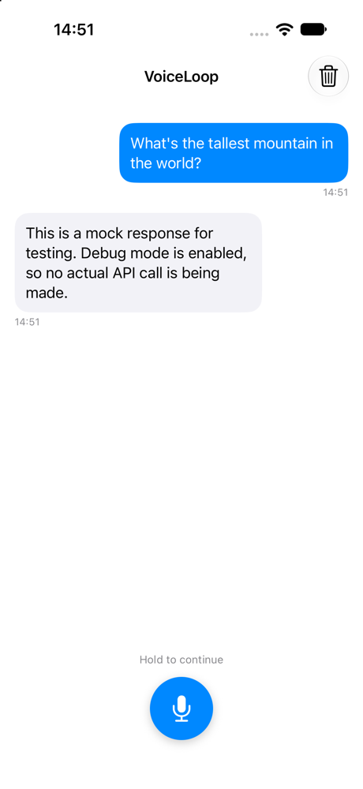
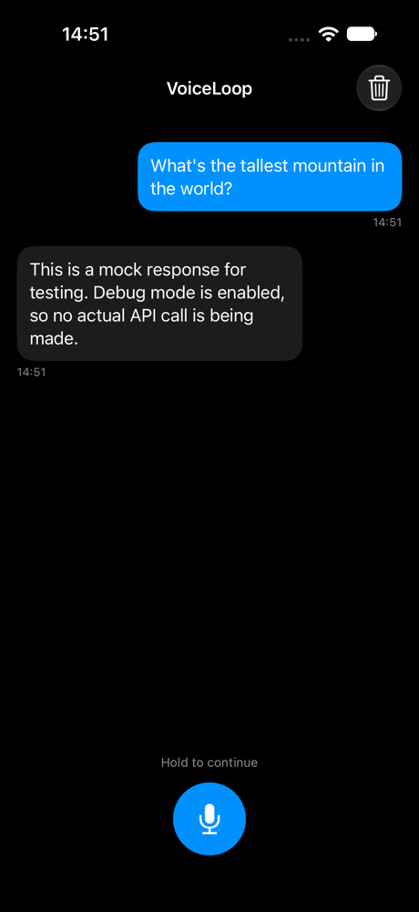

# VoiceLoop — Simple AI Chat

Hold the button, ask a question, and hear the answer. VoiceLoop records your voice, turns it into text
with Apple's Speech framework, sends the conversation to OpenAI's chat API, and reads the reply aloud.
It's a small SwiftUI app built to show clean MVVM, Swift 6 concurrency, and testable design.

<p align="center">
  
  &nbsp;&nbsp;
  
</p>

## Features

- **Hold to talk.** Press and hold to record; let go to send.
- **Speech to text** with Apple's Speech framework, in the language the user set for speech recognition.
- **AI replies** from OpenAI Chat Completions (`gpt-4o-mini`), with the whole conversation as context.
- **Spoken answers** with `AVSpeechSynthesizer`. Stop them at any time, or start talking to interrupt.
- **Clear progress and errors.** The title shows each step. When a retry can help, the error offers
  Try Again, which repeats only the failed step. A missing permission offers a shortcut to Settings.
- **Polite audio.** The microphone session is active only while recording, so other audio keeps playing
  until you speak. Phone calls and Siri interrupt a recording cleanly.
- **Dark mode** and system colors throughout. The record button works with VoiceOver.
- **Debug mode** gives a canned reply, so the app runs without an API key.

## How it works

```
Hold button ─▶ AudioRecorder ─▶ .m4a file
                                   │
                                   ▼
                      AppleSpeechTranscriber ─▶ text ─▶ message list
                                                            │
                                                            ▼
                                             OpenAIChatService ─▶ reply ─▶ message list
                                                                              │
                                                                              ▼
                                                                    SpeechSynthesizer
```

## Architecture

MVVM with one view model and four small services behind protocols.

```
VoiceLoop/
├── VoiceLoopApp.swift        Composition root: builds the services and the view model
├── Views/                    SwiftUI only: ConversationView, MessageRow, RecordButton
├── ViewModels/               ConversationViewModel, ConversationState, ConversationError
├── Services/
│   ├── Audio/                AudioRecording → AudioRecorder (AVAudioRecorder + AVAudioSession)
│   ├── Transcription/        Transcribing → AppleSpeechTranscriber (SFSpeechRecognizer)
│   ├── Chat/                 ChatCompleting → OpenAIChatService
│   ├── Network/              APIClient over an injectable HTTPClient (URLSession)
│   └── Speech/               SpeechSynthesizing → SpeechSynthesizer (AVSpeechSynthesizer)
├── Models/                   Message and the chat request/response types
├── Configuration/            API key, endpoint and model
└── Support/                  os.Logger categories
```

- **Dependency injection.** The view model depends only on the four protocols. `VoiceLoopApp` creates
  the real services; tests pass mocks.
- **State.** `ConversationViewModel` is `@Observable` and moves through one state at a time:
  idle → recording → transcribing → generating → speaking. Each step is an `async` function, so the
  whole flow reads top to bottom and tests can `await` it.
- **Errors.** Each layer has its own error type (`RecordingError`, `TranscriptionError`, `APIError`)
  with a user-facing message. The view model decides how to recover: Try Again repeats only the step
  that failed, so a failed reply doesn't re-transcribe or duplicate your message. A missing permission
  offers Open Settings, and an error a retry can't fix offers neither.
- **Concurrency.** Swift 6 language mode with main-actor default isolation. The app is UI-driven and
  does no heavy work, so everything runs on the main actor, and network calls suspend without blocking
  it. Apple framework callbacks that can arrive on other threads, such as speech recognition, speech
  synthesis and audio interruptions, go through `nonisolated` entry points that hop back explicitly.
- **Privacy.** Logs record request status lines only, never your words or the AI's replies.

## Requirements

- Xcode 26 or later
- iOS 17 or later (iPhone)
- An OpenAI API key, only if you want real replies

## Setup

1. Clone the repository and open `VoiceLoop.xcodeproj`.
2. Create your local settings file. It is git-ignored, so your key never gets committed:

   ```bash
   cp Config/Local.example.xcconfig Config/Local.xcconfig
   ```

3. In `Config/Local.xcconfig`, set `OPENAI_API_KEY`. To run on a device, also set `DEVELOPMENT_TEAM` to
   your Apple team ID. The simulator doesn't need it.
4. To get real replies, set `isDebugMode` to `false` in `VoiceLoop/Services/Chat/OpenAIChatService.swift`.
   While it is `true`, the app answers with a canned message and makes no network calls.
5. Build and run the `VoiceLoop` scheme. Allow microphone and speech recognition access when asked.

> **Note:** A key bundled into an app can be extracted from it. That's fine for running VoiceLoop
> yourself, but an app you ship should call OpenAI through your own backend.

## Running the tests

The tests use Swift Testing and cover the view model's flows (a full turn, retries, interruptions,
interrupting speech) and the network layer (status codes, decoding, missing key). Nothing sleeps or
touches the network.

```bash
xcodebuild test -project VoiceLoop.xcodeproj -scheme VoiceLoop -destination 'platform=iOS Simulator,name=iPhone 17'
```

Use any installed iPhone simulator name. You can also press ⌘U in Xcode.

## License

MIT. See [LICENSE](LICENSE).
